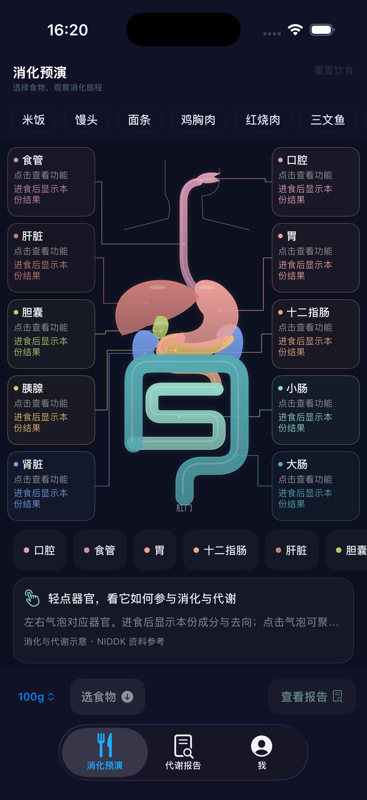
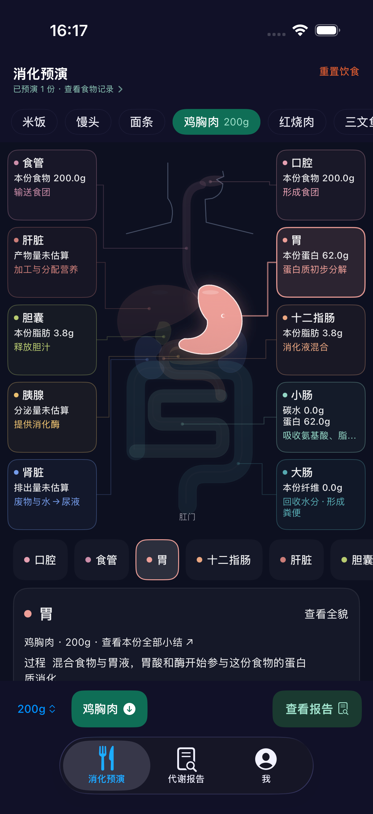

# 食物旅行 · FoodJourney

FoodJourney 是一款使用 SwiftUI 构建的 iOS 互动科普应用。选择食物与份量，观察消化过程示意，并了解不同器官在消化、吸收与代谢中的作用。

项目面向对消化过程好奇的普通成年人，也考虑有慢性病史读者的理解需求。首发计划面向中国大陆，目前仍在开发中，尚未发布到 TestFlight 或 App Store。

> 食物成分与动画用于教育和辅助理解，不代表个人实际吸收量、血糖变化、器官功能或疾病风险，也不能替代个体化诊疗建议。

## 项目状态

截至 2026-09-25，项目处于功能迭代与验收阶段。最近一次有手动功能验收记录的代码为 `2f51672`；新增器官聚焦、饭点提醒与大陆每日参考对照尚待完整运行验收。截图反馈与静态检查不代表全量回归或医学验证。

器官聚焦、饭点提醒及大陆每日参考对照的新实现仅存在维护者本地未提交工作区。本次仅推送文档与资料路径注释，远端 `Dev` 不包含这些实现；下文相应条目记录工作区规格，不能作为克隆版本已具备的功能。

本地与 GitHub 已统一为 `Dev → Stage → Live`，默认分支为 `Live`。当前代码、验证范围与分支进度统一见 [项目状态](docs/project-status.md)；发布门槛见 [发布准备](docs/release-readiness.md)。仓库名为 **FoodJournal**，工程与应用名称为 **FoodJourney**。

## 可以体验什么

- **选择食物**：最近使用 3 种食物和完整目录搜索；32 个公共内部条目中，27 个可选择，5 个待补条目不进入选食列表。
- **按份预演**：提供 50、100、200、300、500 g 选项，逐份播放消化示意；重播不会重复计入本餐。
- **探索器官（本地工作区，待提交）**：在原画布缩放并居中所选器官，以水平、竖直折线连接过程气泡；点“查看说明”在气泡附近阅读完整说明，点黑色空白退出聚焦。新流程待运行验收。
- **查看整餐**：汇总全部已加入份量，按配方版本合并成分、显示主要贡献来源，并保留逐份删除与重置。
- **维护自建食物**：公共库只读；自建食物可在本机新增、修改和删除，加入本餐时保存成分快照。
- **选择学习主题**：按关注主题查看相关成分与科普解释；饮水背景可选，不参与嘌呤合计或风险计算。
- **可选饭点提醒（本地工作区，待提交）**：首次看过有数据的报告并离开报告页时提示一次；可选默认每天 13:00、19:00，或自定两个时间，也可拒绝、在“我”中更改或关闭。源码已接入，待运行验收。

底部保留“消化预演 / 代谢报告 / 我”三栏。聚焦内容使用当前已加入的本份快照；改变下一份食物选择不会改写它，新加入一份后随当前旅程刷新。

每餐按食物目录身份最多 10 种，已有种类可以追加份量。当前餐食是临时预演会话，不提供历史饮食档案。

## 视觉预览

以下截图来自 v3 历史版本，用于说明器官画布的视觉方向；其中食物入口和部分文案已更新，不代表当前完整界面。

<p>
  
  
</p>

更多设计资产见 [器官素材说明](Design/Anatomy/v3/README.md) 和 [图标说明](Design/AppIcon/v2/README.md)。

## 数据如何解释

数值按食物每 100 g 成分与所选份量换算，不是对身体的测量。公共食物的做法、样本和来源口径可能不同，并非全部数据都已完成逐项复核。

- “未提供”“明确为 0”和“微量”分别处理；缺失值不补成 0。
- 部分覆盖的乳糖、嘌呤只展示已有记录的小计，并说明缺项。
- **本地工作区，待提交：**每日参考对照使用大陆食品标签 NRV：脂肪 60 g、碳水 300 g，能量按国标给出的 8,400 kJ／2,000 kcal 标签等价值；不是个人目标或单餐上限。
- 同一工作区变更中，参考比例只用于理解成分量，不因达到 100% 而给出停止追加指令。
- 当前不预测个人血糖、血尿酸、胰岛素分泌或器官代谢能力。

现行规则与来源见 [产品规格](docs/PRD.md)；历史对照见 [v10 整餐关注分析](docs/history/iterations/meal-focus-v10.md)。另见 [食物成分来源](docs/reference/food-composition-v8.md)、[数据审计](docs/reference/food-data-and-urate-audit.md)和尚未接入应用的 [五款标签学习材料](docs/learning/sams-label-pilot.md)。

## 本机数据

无需后端服务或 API Key。当前没有账号、云同步或 HealthKit 接入，也不采集疾病问卷。

| 数据 | 保存方式 |
| --- | --- |
| 公共食物与来源 | 随应用打包的 Swift 数据 |
| 自建食物与最近使用 | App 沙盒内的 JSON 文件 |
| 引导状态、关注主题与饮水选项 | 本机 UserDefaults |
| 饭点提醒设置（本地工作区，待提交） | 本机 UserDefaults；通知由 iOS 调度 |
| 本餐份量与报告 | 当前进程内存，不保存为跨启动历史 |

重置本餐不会删除自建食物。卸载可能导致本机数据丢失，当前没有应用内导出、恢复或云备份功能。完整存储边界见 [项目状态](docs/project-status.md#数据与存储)。

## 本地运行

| 项目 | 配置或验证范围 |
| --- | --- |
| 工具 | Xcode 26.5、iOS 26.5 Simulator Runtime |
| 部署目标 | iOS 26.5 |
| 实现 | Swift、SwiftUI、Canvas；MVVM 与 Observation |
| 验证设备 | 主要为 iPhone 17 Pro 模拟器 |
| 测试框架 | XCTest 单元测试与 UI 测试 |

```sh
git clone https://github.com/ZHERLOCK0213/FoodJournal.git
cd FoodJournal
open FoodJourney.xcodeproj
```

上面的命令检出远端默认分支。开发版的分支名称与迁移状态见 [项目状态](docs/project-status.md#分支迁移)，不要把克隆默认版本当作最新开发版本。

在 Xcode 中选择 **FoodJourney** Scheme 和 **iPhone 17 Pro** 模拟器，按 `⌘R` 运行。真机运行需要配置自己的开发团队与签名。

如需命令行构建，在仓库根目录执行：

```sh
xcodebuild -project FoodJourney.xcodeproj -scheme FoodJourney \
  -destination 'platform=iOS Simulator,name=iPhone 17 Pro' build
```

当前存在过期测试断言，部分单元测试仍使用默认本机存储。运行回归前请先阅读 [开发流程](docs/development-workflow.md#验证与测试隔离)，使用独立测试数据与设备；历史测试数量不代表当前套件全部通过。

## 代码与文档导航

```text
FoodJourney/             SwiftUI 应用、数据模型与本机存储
FoodJourneyTests/        单元测试
FoodJourneyUITests/      界面测试
FoodJourney.xcodeproj/   Xcode 工程
Design/                 器官、图标及历史截图
docs/                   产品规格、版本说明、来源与开发记录
scripts/                器官和图标素材导出脚本
```

先看 [文档目录](docs/README.md)，再按问题选择产品规格、状态、流程、资料依据或历史记录。参与修改前请阅读 [贡献指南](CONTRIBUTING.md)。

## 开放与复用计划

项目正在整理面向公众的资料，并评估未来开源。当前尚未选定开源许可证；代码、数据引用和第三方参考素材的授权范围仍需分别梳理，不能把仓库可访问等同于所有内容已获统一开放许可。正式开源范围和许可将另行公布。
