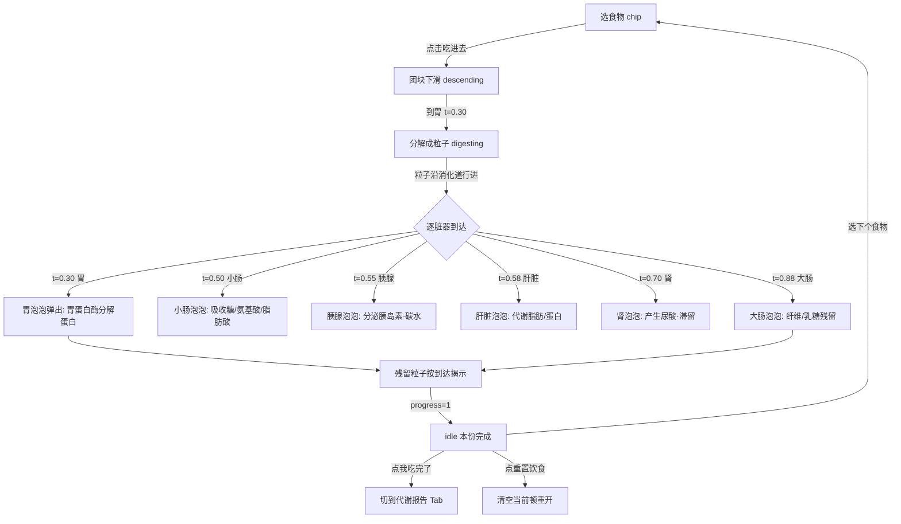
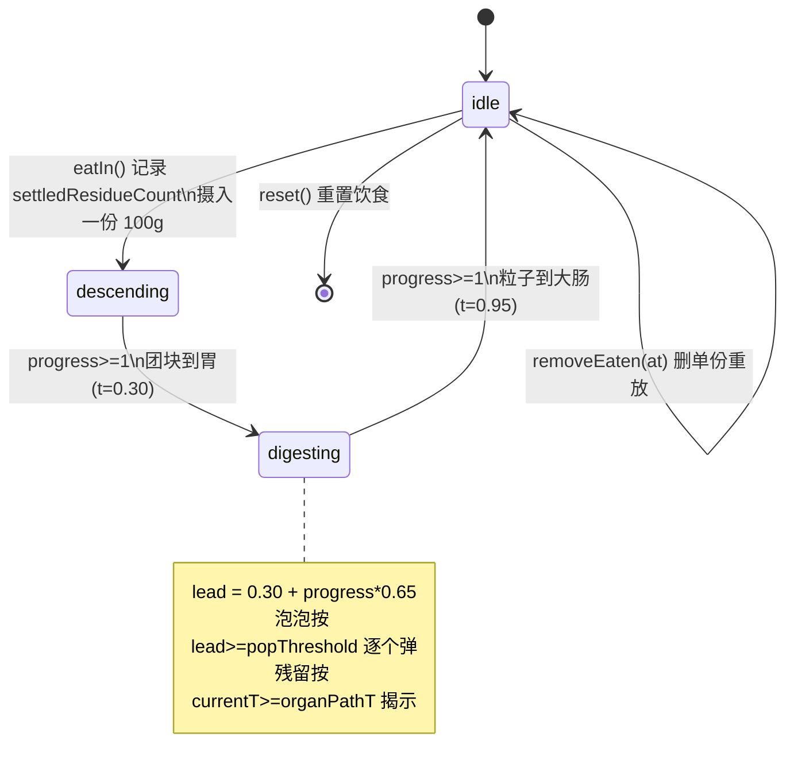
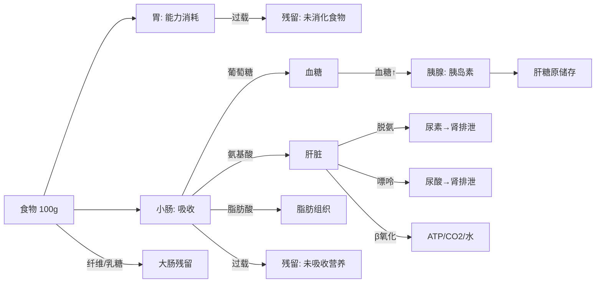

# FoodJourney 产品需求文档（PRD）

| 版本 | 日期 | 作者 | 说明 |
|------|------|------|------|
| v0.1 | 2026-08-12 | zherlock | 初稿，基于 live 会话已实现状态撰写 |

---

## 1. 产品概述

### 1.1 定位
**餐前决策伙伴**——纯教育科普类 iOS App。用户犹豫要不要吃某食物时打开 App，预演它在体内的消化代谢过程，看完可能「劝退」（不吃第 N 份）= 产品成功。

### 1.2 目标用户
- 想了解食物在体内如何代谢的普通用户
- 重点 dogfood 路径：高尿酸血症用户（关注尿酸/肾）、高血糖用户（关注血糖/胰岛素）

### 1.3 核心价值
不是「记录吃了什么」，而是「预演将要吃什么」以影响决策。复访动力 = 下次犹豫时还想用它预演。

### 1.4 边界
- 无账号、无健康数据采集、无个人档案
- 非医疗用途，文案只用「了解/查看/学习」，不做医疗声明
- App Store 类目：Health & Fitness（展示用途）

---

## 2. 用户场景

**场景 A（高尿酸用户）**：饭前想喝啤酒吃海鲜，打开 App 选三文鱼+鸡胸肉预演，看到肾排泄尿酸、滞留累积，决定少吃一份。

**场景 B（高血糖用户）**：犹豫要不要加一碗米饭，预演后看到胰腺胰岛素响应、肝糖原储存，决定不加。

**场景 C（好奇用户）**：想知道西兰花为什么消化不完，看到膳食纤维残留在大肠。

---

## 3. 产品架构

### 3.1 信息架构（底部三 Tab）

```
消化预演（Tab 0）  |  代谢报告（Tab 1）  |  我（Tab 2）
```

- **消化预演**：常驻消化道画布，选食物→吃进去→看动画
- **代谢报告**：当前顿的累积代谢报告（含问卷「镜头」分析）
- **我**：问卷结果（慢性病 + 关注指标），可修改

### 3.2 入口流程

首次启动 → 问卷引导（OnboardingView）→ 消化预演主屏。

---

## 4. 核心交互主流程



### 4.1 串行状态机

严格串行：一份动画全部完成前「吃进去」按钮置灰；完成后才送下一份。



### 4.2 代谢数据流



> ⚠️ 上图为**目标态**。当前实现中：尿酸错误挂在肾「产生」（应为肝产生）、缺尿素、吸收物维度（血糖/胰岛素）未可视化。详见 `metabolism-research.md`。

---

## 5. 功能详述

### 5.1 消化预演（Tab 0）

**食物选择**
- 顶部横向 chip 列表（12 种常见中国食物）
- 点选高亮，固定 100g/份
- 底部「[食物名]·吃进去」按钮

**画布渲染**（240×370 坐标系，自适应缩放）
- 人体剖面轮廓（头/颈/肩/躯干/髋，半透明填充）
- 躯干腔体 + 脊柱暗示线（解剖纵深）
- 消化道路径（Catmull-Rom 样条）
- 8 个脏器：口腔/食道/胃/小肠/大肠 + 胰腺/肝/肾（统一 `drawOrgan` 风格）
- 动画层：团块（descending）→ 粒子流（digesting，末端 alpha 衰减=吸收消失）

**产物泡泡**
- 画布两侧弹出，虚线连线指向对应脏器
- 按产物出现顺序逐个弹（easeOutCubic 缩放 0.5→1 + 淡入）
- 文字按「·」或长度折行
- 临时性：下一份吃入时清掉

**残留粒子**
- 跨份累积保留
- 尾标用物质名（膳食纤维/乳糖/尿酸/脂肪），不用食物名
- 同脏器多份纵向居中铺开不重叠
- 本份新增按粒子到达脏器位置揭示（已沉淀的始终显示）

**已吃入列表**
- navbar「已吃入 N 份」可点开 sheet
- 列出各份，支持删单份（点错重复时用，重放后能力/残留重算）

**重置饮食**
- navbar 右上「重置饮食」按钮（带确认弹窗）
- 清空当前顿重开，不做跨顿累积、不留历史

### 5.2 代谢报告（Tab 1）

- 累积代谢：热量 / ATP / CO₂ / 水 / 尿酸滞留
- 「基于你的关注」镜头分析（引用问卷答案）
- 权威营养学引用注脚
- 仅反映当前顿

### 5.3 我（Tab 2）

- 问卷结果可改：①是否慢性病 → 病种；②最在意指标（血糖/尿酸/胰岛素/热量）
- UserDefaults 本地持久化，不存身份信息
- 慢性病仅作报告「镜头」用，**不**降低脏器能力

---

## 6. 代谢模型（核心差异化）

### 6.1 脏器能力模型

- 有能力值脏器：胃/小肠/肝/胰/肾（大肠为残渣堆积地，无能力值）
- 一顿内单调递减不恢复；`reset()` 开下一顿
- 剩余能力 < 食物所需 → 过载：超出变不可吸收残留 + 降产 + 报告标注

### 6.2 当前产物泡泡映射

| 脏器 | 触发条件 | 泡泡内容 | 路径 t |
|------|---------|---------|--------|
| 胃 | 总是 | 胃蛋白酶分解蛋白 | 0.30 |
| 小肠 | 总是 | 吸收糖/氨基酸/脂肪酸 | 0.50 |
| 胰腺 | 碳水>1 | 分泌胰岛素·碳水Xg | 0.55 |
| 肝脏 | 脂肪>1 或 蛋白>1 | 代谢脂肪/蛋白→ATP | 0.58 |
| 肾 | 蛋白>1 | 产生尿酸Xmg（·滞留Ymg） | 0.70 |
| 大肠 | 纤维>0 或 乳糖>0 | 纤维Xg/乳糖Yg残留 | 0.88 |

### 6.3 待重构（研究已备好）

见 `metabolism-research.md`：尿酸改肝产肾排、加尿素、加吸收物维度、按嘌呤而非蛋白算、重标定常数。

---

## 7. 交互规范

- **严格串行**：上一份动画完成前「吃进去」置灰
- **动画时序**：descending 1.2s → digesting 3.5s
- **状态机驱动**：Timer 1/60s 推进，不在 Canvas 渲染期改被观察属性
- **克重**：暂固定 100g/份，未来在「吃进去」时输入

---

## 8. 非功能需求

- **平台**：iOS 17+，SwiftUI + Canvas
- **架构**：MVVM，@Observable（iOS 17 Observation）
- **性能**：单顿最多 5–10 份，Canvas + TimelineView(.animation) 60fps
- **构建**：`xcodebuild -project FoodJourney.xcodeproj -scheme FoodJourney -destination 'platform=iOS Simulator,name=iPhone 16' build`
- **bundle id**：`ZHERLOCK.FoodJourney`

---

## 9. 待办与延后

| 优先级 | 事项 | 依据 |
|--------|------|------|
| 高 | 代谢模型重构（尿酸归属/尿素/吸收物/嘌呤） | `metabolism-research.md` |
| 中 | 食物数据库扩展（数据来源+审核，补高嘌呤食物） | 单开一轮 |
| 中 | 旧三屏流程清理（FoodInputView/DigestiveView/Summary） | 已不可达 |
| 低 | 风格统一重构（@Published/@Observable 混用） | 最后单独一轮 |
| 低 | 粒子按营养素着色 / 泡泡视觉打磨 | 可选 polish |

---

## 附：食物数据库（当前 12 种）

米饭、馒头、面条、鸡胸肉、红烧肉、三文鱼、豆腐、鸡蛋、西兰花、苹果、牛奶、香蕉

每项含 per-100g：碳水/脂肪/蛋白质/纤维/乳糖/热量。默认 100g/份。
